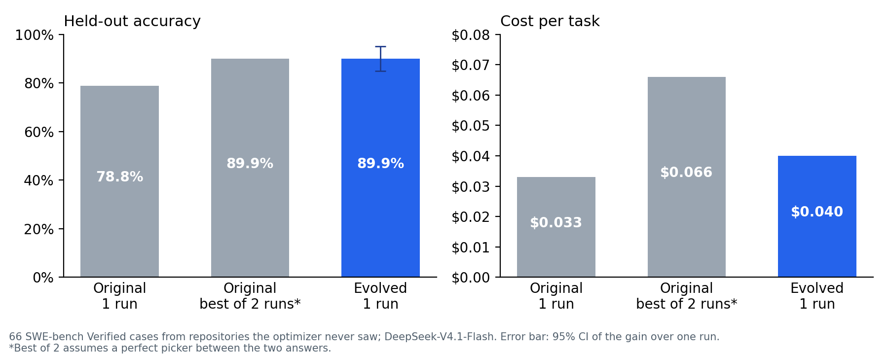

# harness-evolve

Improve an AI agent's harness (its prompts, tool descriptions and settings) from the agent's own failure
traces, and keep a change only when it beats measured run-to-run noise.

Agents are noisy: run the same agent on the same task twice and the result can flip. Tune a prompt,
rerun, see +3 points, and you may have measured nothing. harness-evolve measures that noise first,
then accepts an edit only if it clears it, checks it doesn't break the cases that already work, and
reports the result on cases it never saw, against the cheapest alternative: just running the original
agent twice.

## Results

Used on a production code-diagnosis agent ([agent-platform](https://github.com/sidreddy88/agent-platform)), on SWE-bench Verified with
DeepSeek-V4.1-Flash:



| Held-out: 66 cases from repositories the optimizer never saw | Original harness | Evolved harness |
|---|---|---|
| Finds the file the fix must change (single run) | 78.8% | **89.9%** (+11.1, 95% CI +6.1 to +16.2) |
| Gives up with no answer | 19.7% | 5.6% |
| Solves it on all 3 trials (reliability) | 60.6% | 78.8% |

The evolved harness matched running the original twice (best-of-2) at about 60% of the cost.
Two edits were accepted in a 7.4-hour run, and the evolved harness went to production.

It also says no. An earlier run of the same optimizer on Claude Sonnet 5 accepted nothing, and so
did a three-round run on the same project's fix agent: every candidate edit either stayed inside the
noise band or broke a guard case. Halfway through that run, one edit led 7 to 4, and a single
measurement would have reported it as a gain.

## Quickstart

The example is a small math agent (a calculator tool and a submit tool) on GSM-Hard, GSM8K questions
with large, awkward numbers, where how the agent uses its calculator matters.

```bash
git clone https://github.com/sidreddy88/harness-evolve && cd harness-evolve
pip install -e ".[litellm]"
python examples/math_agent/fetch_data.py      # downloads 80 problems
export TOGETHER_API_KEY=...                   # or any litellm provider; set MODEL to match
harness-evolve run examples/math_agent/config.py --run-dir runs/math-1 --budget 2
harness-evolve status runs/math-1
harness-evolve diff runs/math-1               # accepted edits, as diffs to review
```

`--budget` is a hard cap in dollars. A run that stops (budget, Ctrl-C, a provider outage) resumes with
the same command, and nothing already paid for is paid again.

## How a run works

```
round 0   run the starting harness on the evolve cases, 2 trials each
          -> the noise band (how much the pass rate moves between identical runs)
round r   propose one edit, aimed at failures in the trajectories (GEPA-style)
          -> structural checks (free)
          -> a critic screens for leakage, gaming and weakened safeguards (cheap)
          -> evaluate the candidate (the only expensive step)
          -> accept only if it beats the noise band, or is cheaper beyond cost noise
             at the same pass rate, and no guard case regresses
final     original vs evolved on held-out cases, k trials each, including the
          original's best-of-2 (the matched-budget rerun baseline)
```

Accepted edits are written as diffs under `runs/<id>/proposals/` for you to review; your code is never
changed automatically.

Built for long unattended runs: every phase is checkpointed; every case's result is cached by the
candidate's content hash; a hard budget is checked before each case; provider failures (billing, auth,
rate limits) stop the run instead of being scored as failures; tripwires pause it when measurements
look broken; a watchdog exits cleanly if it stops making progress.

## Using it on your agent

You need five things.

**1. A harness directory your agent reads at run time**

```
my_harness/
  system.prompt              # templates, rendered with str.format
  task.prompt
  tool_descriptions.json     # {"search": "Search the docs ..."}
  settings.json              # {"max_turns": 12, "_doc": {"max_turns": "turn budget"}}
```

Load it with `harness_evolve.load_harness(path)`. The optimizer edits copies of these files, never
adds or deletes files, and checks every edit still loads.

**2. An evaluator**

```python
class MyEvaluator:
    async def evaluate(self, harness_dir, case_ids, trials) -> EvalOutcome:
        ...  # run your agent with harness_dir on each case, `trials` times
```

Return pass/fail and cost per trial, and trajectories if you can: the proposer reads them to find
out why runs fail. Raise `ProviderFailure` for billing, auth or outage errors. Never let the right
answer reach the proposer: put it after `evidence.HIDDEN_MARKER` in a trajectory's `detail`.
See `examples/math_agent/evaluator.py`.

**3. A profile**

```python
from harness_evolve import AgentProfile, profiles
profiles.use(AgentProfile.build(
    name="support-bot", harness_root="my_harness/",
    agent_description="Answers support tickets with search and read tools; finishes by calling reply.",
    safety_mechanisms=["citing a source document for every claim"],
    setting_bounds={"max_turns": (3, 20)}))
```

The description and safety mechanisms become the proposer's and critic's instructions; setting
bounds keep an edit from "saving cost" by starving the agent.

**4. Cases**: an evolve set (what it improves on, ideally 50+), optional guard cases (must keep
passing) and held-out cases (never seen during evolution, for the final report).

**5. A model for the proposer and critic, and a budget**: `litellm_llm("model-id", prices=(in, out))`
or any async `(system, prompt) -> LLMReply(text, cost_usd)`.

Then:

```python
opt = Optimizer("runs/r1", "my_harness/", OptimizerConfig(evolve_cases=..., budget_usd=50),
                evaluator=MyEvaluator(), proposer_llm=llm, critic_llm=llm, critic_patterns=[])
asyncio.run(opt.run_until_stopped())
```

Or put a `build(run_dir, budget_usd, rounds)` function in a config file and use the CLI, as the
example does.

## Limits

- It needs an automatic pass/fail check per case. No grader, no optimizer.
- A noisy agent needs more cases or trials before any gain is detectable; the noise band will tell
  you, and "nothing accepted" is a real answer.
- Every candidate costs a full evaluation. Slow or expensive agents make slow, expensive runs.

## Credits

- Reflective, trace-driven proposals: GEPA (Agrawal et al., "GEPA: Reflective Prompt Evolution Can
  Outperform Reinforcement Learning", ICLR 2026).
- The critic and the one-edit-per-round discipline: RRSI (google-research/rrsi, Apache-2.0); the
  critic's reject classes are adapted from its prompt.
- Comparing against reruns: AI2's finding that harness evolution rarely beats simply rerunning
  (arXiv 2607.12227), which is why the final report includes the matched-budget rerun baseline.

MIT license.
